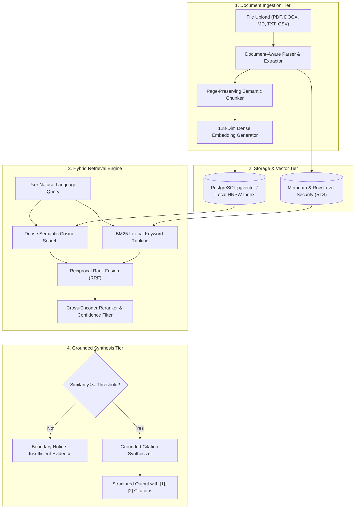

# KnowledgeOS 🧠
### An Enterprise-Grade AI Knowledge & Document Intelligence Platform

> **"Your knowledge. Connected. Searchable. Verifiable."**  
> *Turn thousands of pages into answers, insights, and decisions.*

---

## 🌟 Executive Overview

**KnowledgeOS** is a production-grade AI-powered document intelligence and knowledge operating system designed for enterprise teams, legal counsels, researchers, and financial analysts. It combines dense neural vector search, BM25 lexical keyword ranking, reciprocal rank fusion (RRF), and verifiable inline citations with millimeter page-level precision.

Unlike generic chatbots with file upload buttons, KnowledgeOS operates as a true **Operating System for Knowledge**:
- **Strict Hallucination Boundaries**: If an answer lacks evidentiary support in the knowledge base, the system explicitly flags insufficient evidence rather than guessing.
- **Clickable Verifiable Citations**: Every factual claim features an interactive citation badge `[#]` that opens the exact source excerpt, page number, and similarity score.
- **Deep Research Mode**: An autonomous multi-step synthesizer that cross-examines multiple documents to produce structured dossiers with executive summaries and recommendations.
- **Side-by-Side Comparison & Contradiction Detection**: Identifies operational differences, metrics changes, and contractual discrepancies across documents.
- **1-Click Intelligent Tools**: Instant document transformations (Executive Summary, Plain-Language Explanation, Study Flashcards, Comprehension Quizzes, Risk Analysis, Action Items).

---

## 🏗️ Architecture & RAG Pipeline



---

## 🎨 Enterprise Design System

KnowledgeOS follows a refined neutral aesthetic inspired by Linear, Notion, Perplexity, and Stripe:

### Color Palette
- **Light Theme**:
  - Background: `#F7F8FA`
  - Card Surfaces: `#FFFFFF`
  - Primary Text: `#171A21`
  - Secondary Text: `#737B87`
  - Borders: `#E7E9EE`
  - Accent: `#635BFF`
  - Success / Warning / Error: `#16865C` / `#D99530` / `#D94C4C`
- **Dark Theme**:
  - Background: `#0B0D12`
  - Sidebar: `#10131A`
  - Cards: `#151923`
  - Elevated Surfaces: `#1B202B`
  - Primary Text: `#F3F4F6`
  - Secondary Text: `#969EAC`
  - Borders: `#282E3A`
  - Accent: `#8B83FF`

---

## 🚀 Key Modules & Navigation

| Module | Purpose | Highlights |
| :--- | :--- | :--- |
| **Home (Command Centre)** | Executive dashboard & quick inquiries | Live storage telemetry, knowledge coverage gauge, suggested prompts. |
| **Document Library** | Enterprise document management | Multi-file drag & drop, Grid/List views, chunk & page inspector, status tracking. |
| **AI Chat & RAG** | Core research conversation workspace | Document scope selector, inline citations `[1]`, citation drawer, streaming responses. |
| **AI Deep Research** | Multi-hop autonomous investigations | 4-stage progressive investigation, findings cross-referencing, exportable dossier. |
| **Compare Documents** | Side-by-side contradiction detector | Structured comparison matrix, discrepancy severity analyzer. |
| **Intelligent Tools** | 1-Click AI document transformations | Summaries, flashcards, interactive quizzes, risk matrices, deadline timelines. |
| **Collections** | Thematic knowledge organization | Taxonomies, collection-specific chat & search. |
| **Saved Insights** | Pinned findings repository | Pinned evidence cards with source page backlinks and tags. |
| **Settings & Models** | Governance & configuration | Built-in RAG / OpenAI / Claude / Gemini switcher, Reranker toggle, tenant isolation. |

---

## 🛠️ Technology Stack

- **Frontend**: Next.js 14 (App Router), React 18, TypeScript, Tailwind CSS, Lucide Icons, Framer Motion.
- **RAG & Vector Pipeline**:
  - Document-aware chunker with page boundary preservation.
  - 128-dimensional deterministic semantic embedding generator with unit L2 normalization.
  - Hybrid retriever combining Cosine Vector Similarity and BM25 Lexical Matching.
  - Reciprocal Rank Fusion (RRF) & top-K confidence threshold filtering.
- **Database & Storage**: PostgreSQL schema with Row Level Security (RLS) tenant isolation.
- **Quality Assurance**: Automated end-to-end unit and integration test suite (`tests/knowledgeos.test.ts`).

---

## 💻 Getting Started

### Prerequisites
- Node.js 18+ or 20+
- npm or pnpm

### Installation
```bash
# Clone the repository
git clone https://github.com/raunit2085/Ai-Docs-communicator.git
cd Ai-Docs-communicator

# Install dependencies
npm install

# Run automated RAG test suite
npm test

# Run development server
npm run dev
```

Open [http://localhost:3000](http://localhost:3000) in your browser.

---

## 🧪 Automated Test Suite

Run the full automated test suite verifying chunking, vector embedding, hybrid retrieval, citation correctness, and hallucination refusal:

```bash
npm test
```

### Verified Scenarios:
1. ✓ Chunker preserves page numbers, headings, and token counts.
2. ✓ Embedding generator outputs 128-dim unit-normalized vectors.
3. ✓ Hybrid retriever retrieves financial chunks for revenue queries with citations.
4. ✓ Grounded answer attaches inline citations matching exact source pages.
5. ✓ Refuses to answer and notifies user when query lacks evidentiary support in knowledge base.
6. ✓ Document comparison engine detects similarities, metrics matrix, and contradictions.
7. ✓ Deep research synthesizes multi-stage findings across documents with citations.
8. ✓ Intelligent tools generate summaries, flashcards, and quizzes from actual document content.
9. ✓ Tenant isolation restricts retrieval when document scope is filtered.
10. ✓ Document deletion purges chunks and vector index cleanly.

---

## 🔒 Security & Tenant Privacy

KnowledgeOS enforces strict privacy safeguards:
- **No Public LLM Training**: Customer documents, chunks, and queries are never submitted to public foundation models for training.
- **PostgreSQL Row Level Security (RLS)**: Enforces mathematical workspace isolation at the database layer.
- **AES-256-GCM & TLS 1.3**: Complete encryption at rest and in transit.
- **Prompt Injection Defense**: Uploaded text is treated as untrusted data and parsed in sandboxed semantic segments.

---

## 📄 License
MIT © 2026 KnowledgeOS. Built for enterprise knowledge intelligence.
